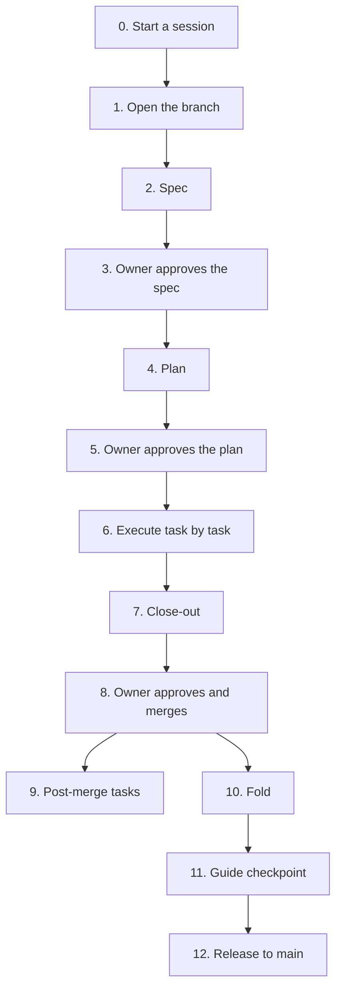

# Workstream workflow

How a workstream goes from the Upcoming list to `Done`, with the skills in `.claude/skills/` and the
branch model in `AGENTS.md` § 1. `INT` is the integration branch (`development`); `main` is the release
branch and only receives `development` by pull request.

Who acts: **Owner** (the project owner), **Agent** (an AI session), **Human** (anyone with account access).
An agent never sets `Approved`, never merges, and never enters credentials or tokens.

## 0. Every session

- Agent reads `PROJECT_STATE.md` in full, then the branch state if on a branch, then runs `git log --oneline -20` and
  `git status` (`maintaining-project-state`).
- Resolve `INT` (`maintaining-project-state` § Branch Model). A resumed session continues at the **Next action** of its row in the
  branch state's Sessions table.
- A decision, a started or finished task, a changed plan: written to the branch state immediately, not at the end.

## 1. Open the branch

| Do | Who | Output |
|---|---|---|
| Pick the first Upcoming row (or the owner names one) and branch from `INT`: `git switch -c <workstream> origin/development` | Agent | the branch |
| Copy `branch-state-template.md` to `docs/project-state/branch-states/<slug>.md`; keep **every** `PROJECT_STATE.md` heading, and write `No change.` where nothing changes | Agent | branch state, Status `Draft`, a session row |
| Check the Upcoming row against Known Gaps, Conventions and out-of-scope (`AGENTS.md` § 4); if the request collides, stop and ask: keep the decision or reverse it | Agent | an answer, recorded as a decision |

Anything feature-sized needs a spec and a plan. A bug fix or config tweak does not, but it still gets a Changes line.

## 2. Spec (`writing-specs-lite`)

1. Agent writes the spec: an index at `docs/superpowers/specs/YYYY-MM-DD-<topic>-design.md` plus a folder of component files
   (requirements, data model, API, UI, conventions, edge cases `E1..`, implementation order `T1..`).
x
3. `node .claude/skills/writing-specs-lite/scripts/lint.mjs spec <index.md>` has no errors.
4. Review by the read-only `lite-reviewer` agent, one per lens, scaled by tier: Low = Implementer + Tester; Medium adds Maintainer + User; High = all five, and the
   Attacker lens writes a threat list (actor, abuse, mitigation present or missing). At most **two rounds**; unresolved blocking findings become open questions for the owner.
   (The W-INFRA trial found four lenses overlapped heavily; see the Upcoming todo on revising the skills.)
5. Open questions (`Q`) go to the owner. Decisions the owner makes are recorded as `C~n` in the branch state.

Gate: the owner reads the spec. **Owner approves** (Status `Approved (name, date)`). Nothing is built before this.

## 3. Plan (`writing-plans-lite`)

1. Agent writes `docs/superpowers/plans/YYYY-MM-DD-<topic>.md`: tasks `T1..Tn` mirror the spec's implementation order; exact
   files; a checklist per task; snippets for tricky logic; a Traceability table for every `F`, `N` and `E` ID; Close-out last.
2. Mark human-only work after the merge as a **`Post-merge`** task. Start any step that leaves the machine (push, PR, deploy,
   credentials) with **`GATE:`**.
3. Write real build and test commands for each component (`desktop/`, `backend/`, `frontend/`); `<BUILD>` means all of them at wave checks and close-out.
4. `lint.mjs plan <plan.md>` has no errors; one `lite-reviewer` pass for Medium and High; at most two rounds.

Gate: **owner reviews the plan** before any code is written.

## 4. Execute (`executing-plans-lite`)

Per task, in dependency order and waves:

1. Set the task `In progress`; update the session row (task and step).
2. Tests first, then code; tick each box in the plan as it finishes.
3. Every `E` ID assigned to the task has a test that cites it.
4. Run the task's tests and the component's build. **Do not continue on red.**
5. Set the task `Done`; update Progress (about 15 words) and add a Changes line.
6. Commit (code, tests, plan ticks, branch state together; no `git add -A`; `type: what and why (workstream)`; a handful of files).
7. After each wave: `lint.mjs plan` and every component build.

Stop conditions:
- Reality differs from the plan (missing path, impossible rule, new edge case): write a Deviation `D~n`. Plan-only fixes are made and
  recorded; anything that changes behaviour or scope goes back through spec change control and, if needed, the owner.
- A `GATE:` step: say what it will do, mark the session `Blocked — needs human`, wait for the owner's yes in the conversation; the yes covers that step only.
- An outage (Docker, network, an account): record it in the session row and stop; never tick a step that did not run.
- Pushing, opening a PR and pushing throwaway commits are gated steps. After a PR exists, CI runs once per commit.

## 5. Close-out

1. `lint.mjs plan <plan.md> --closeout`: all boxes ticked, every task `Done` except `Post-merge` ones, which become **Handover** items.
2. Every component build is green; each `F`/`N` has a passing test or a recorded manual check; say plainly which checks could not run.
3. Code review of the branch diff (`code-review` skill). Fix confirmed findings or record them as Deviations.
4. Branch state: workstream `In review`, session rows deleted, Changes lines complete, and every `PROJECT_STATE.md` heading either
   updated (Architecture area **Now**, Conventions, Known Gaps, Decisions, Deviations) or marked `No change` with a reason. Guide cell stays `—` with
   `guide out of date: <what>` if the guide is affected.
5. Agent tells the owner the branch is ready. Open the PR into `development` (a `GATE:` step).

## 6. Approve and merge (Owner)

- Owner reviews the PR and the branch state, sets `Status: Approved` with name and date, and merges into `development`.
- Not mergeable until `Approved` and the session table is empty.
- CI: `checkstyle` and `build` are required and cover all three components. A push to a branch with an open PR does not run twice; a push that
  changes only `PROJECT_STATE.md`, `AGENTS.md` or `docs/**` does not run CI.

## 7. After the merge

| Step | Who | Skill or action |
|---|---|---|
| Post-merge tasks (deploys, data changes, DNS, secrets) | Human | the plan's `Post-merge` tasks; evidence goes in the runbook; the workstream stays `In review` until the owner confirms |
| Fold the branch state into `PROJECT_STATE.md` and the Done ledger, allocate permanent IDs, archive the branch state | Owner runs it, on `development` | `sync-project-state` (checks every `No change` claim against the diff; commits locally, never pushes) |
| Developer guide checkpoint | Owner confirms, agent proposes, owner approves, agent writes on `development` | `update-documentation`: Guide `Awaiting confirmation` → `Pending` → `Documented` |
| Release | Owner | pull request `development` → `main` |

## Artifacts by stage

| Stage | Files |
|---|---|
| Branch | `docs/project-state/branch-states/<slug>.md` |
| Spec | `docs/superpowers/specs/YYYY-MM-DD-<topic>-design.md` and its folder |
| Plan | `docs/superpowers/plans/YYYY-MM-DD-<topic>.md` |
| Code | `desktop/`, `backend/`, `frontend/`, `docker-compose.yml`, `render.yaml` |
| State | `PROJECT_STATE.md`, `docs/project-state/done-ledger.md`, `.../archive/` |
| Guide | `docs/DeveloperGuide.md` |

## Commit and branch rules

Small commits, each building green (`AGENTS.md` § 6); one logical change per commit; descriptive messages; provisional IDs (`C~1`) never appear
outside the branch state. `PROJECT_STATE.md` and the guide are written only on `development`.
