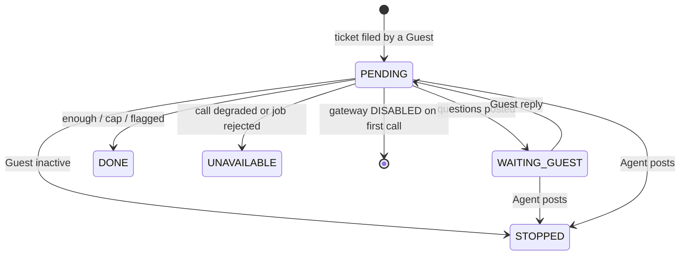

# Data Model

## Entities

### `ticket_assistants` (new; one row per Guest-filed ticket while the assistant runs or after it ran)
| Entity | Attribute | Type | Null | Default | Range / rule |
|---|---|---|---|---|---|
| TicketAssistant | `ticket_id` | UUID | no | - | primary key; foreign key to `tickets(id)` |
| TicketAssistant | `state` | VARCHAR(16) | no | - | one of `PENDING`, `WAITING_GUEST`, `DONE`, `STOPPED`, `UNAVAILABLE` (CHECK) |
| TicketAssistant | `rounds` | SMALLINT | no | 0 | 0 to 5 (CHECK); the number of question messages posted |
| TicketAssistant | `flagged` | BOOLEAN | no | false | true once any call had `flagged = true` |
| TicketAssistant | `draft` | TEXT | yes | null | the rendered report, at most 6,000 characters (CHECK `char_length(draft) <= 6000`) |
| TicketAssistant | `draft_updated_at` | TIMESTAMPTZ | yes | null | set whenever `draft` is written |
| TicketAssistant | `last_message_id` | UUID | yes | null | the newest Guest message (ordered by `sent_at`, then `id`) used by the last applied call; foreign key to `messages(id)` |
| TicketAssistant | `created_at` | TIMESTAMPTZ | no | - | row creation time |
| TicketAssistant | `updated_at` | TIMESTAMPTZ | no | - | last state or draft change, and the time of the last change into `PENDING` |

### `messages` (existing; one constraint changes)
| Entity | Attribute | Type | Null | Default | Range / rule |
|---|---|---|---|---|---|
| Message | `author_role` | VARCHAR(10) | no | - | CHECK widens from `GUEST, HOST, AGENT` to `GUEST, HOST, AGENT, SYSTEM` (see Q1 in the index) |
| Message | `author_id` | UUID | no | - | for assistant messages: the SYSTEM user `a0000000-0000-0000-0000-0000000000ff` (V004) |

No other table changes. `tickets`, `audit_log` and `booking_messages` are unchanged; `audit_log.action_type` has no CHECK, so two new `AuditAction` constants need no migration.

**Thread order.** A thread is ordered by `(sent_at, id)` ascending wherever this spec says "newer", "newest" or "last". `MessageRepository.findThread` returns it descending, so the job reverses it. "Newer than `last_message_id`" means a Guest-authored message with a greater `(sent_at, id)` than that message; when `last_message_id` is null it means any Guest-authored message in the thread.

## Keys and relationships
| From | To | Cardinality | On delete | Ownership / tenancy scope |
|---|---|---|---|---|
| `ticket_assistants.ticket_id` | `tickets.id` | 1 to 0..1 | no cascade (tickets are never deleted) | read only through Agent endpoints; a Guest or Host endpoint never returns it |
| `ticket_assistants.last_message_id` | `messages.id` | many to 0..1 | no cascade | internal |
| assistant `messages.author_id` | `users.id` (SYSTEM user) | many to 1 | no cascade | visible only in the ticket's GUEST thread to its Guest and to Agents |

## Lifecycle
The row is created in `PENDING` by the listener at submission, before the first call, so every in-flight call has a row. Transitions into `PENDING` are bookkeeping and are not audited; every transition out of `PENDING`, and `WAITING_GUEST` to `STOPPED`, writes one `ASSISTANT_STATE` audit row.

| From state | To state | Triggered by (role) | Guard |
|---|---|---|---|
| (no row) | `PENDING` | `TicketOpenedEvent` listener (SYSTEM) | the ticket was filed by a Guest; `rounds = 0`; a duplicate-key conflict is ignored |
| `PENDING` | `UNAVAILABLE` | listener (SYSTEM) | the executor rejected the job |
| `PENDING` | (row deleted) | assistant job (SYSTEM) | the gateway returned `DISABLED` on the first call (`rounds = 0`, no draft), or the ticket's `raised_by_role` is not `GUEST`; no audit row |
| `PENDING` | `WAITING_GUEST` | assistant job (SYSTEM) | call ok, not flagged, `enough` false, at least one screened question, `rounds` below the current `max-rounds`; `rounds` +1; the question message is posted |
| `PENDING` | `DONE` | assistant job (SYSTEM) | call ok and (`flagged`, or `enough`, or no screened question, or `rounds` at or above the current `max-rounds`); the closing message is posted if `rounds >= 1` |
| `PENDING` | `UNAVAILABLE` | assistant job (SYSTEM) | call degraded (any code, including `DISABLED` after the first call); the draft is unchanged; the closing message is posted if `rounds >= 1` |
| `PENDING` | `STOPPED` | assistant job (SYSTEM) | the Guest's account is not `ACTIVE` when the job starts; no call |
| `PENDING` | `WAITING_GUEST` | assistant job (SYSTEM) | the built turns do not end with a Guest turn (defensive); no call, no audit row |
| `WAITING_GUEST` | `PENDING` | `MessagePostedEvent` listener for a Guest message in the GUEST thread (SYSTEM) | the compare-and-set update changed one row and the ticket is `OPEN` or `IN_REVIEW` |
| `WAITING_GUEST`, `PENDING` | `STOPPED` | `MessagePostedEvent` listener for an Agent message in the GUEST thread (SYSTEM) | conditional update on the two states |

`DONE`, `STOPPED` and `UNAVAILABLE` are terminal: no transition leaves them. A ticket resolved while the row is non-terminal is not changed by the assistant: the next trigger finds the ticket resolved and does nothing (the Guest cannot post to a resolved ticket either), and a job in flight discards its result. A Guest reply that arrives in a terminal state starts nothing and the Guest is told nothing; the thread then works as a normal Guest-to-Agent thread.

## Invariants
- At most one `ticket_assistants` row per ticket (primary key).
- `rounds` equals the number of messages by the SYSTEM user in the ticket's GUEST thread that contain questions (closing messages do not count).
- A call to the model starts only when `rounds` is below `max-rounds`, or when it is the final refresh call after the last round was answered; `rounds` never exceeds 5, and after a configuration change it may exceed the new `max-rounds`, in which case the next call ends the exchange.
- `state = 'WAITING_GUEST'` implies the newest assistant message in the GUEST thread is a question message.
- A row in a terminal state is never updated again, including `updated_at`.
- `agent_notes` is never written by an assistant code path.
- No `ticket_assistants` or assistant `messages` row exists for a ticket whose `raised_by_role` is `HOST`.
- `draft` is null until the first ok call is applied, and is replaced, never appended, by each later ok call; a degraded call leaves it unchanged.

## Migration and rollback
- Version: `V006__ticket_assistant.sql`. If another branch merges a `V006` first, this file is renumbered at merge, as W-DOMAIN did when W-AUTH had already taken V002.
- Existing rows: none are transformed. Existing tickets have no `ticket_assistants` row, which reads as "assistant did not run" (the detail response carries `assistant: null`). The `messages.author_role` CHECK is dropped with `DROP CONSTRAINT IF EXISTS messages_author_role_check` (the name Postgres generates for the inline CHECK of V003, commented in the file) and recreated with the four values; every existing row already satisfies it. T1's migration test reads the constraint name from `pg_constraint` before V006 runs, so a wrong name fails the test instead of leaving the old CHECK in place.
- Regenerate committed data: no. `desktop/db/*` is the desktop reference database and is unaffected; the backend has no committed seed for tickets.
- If it fails halfway: Flyway runs the migration in one transaction on PostgreSQL, so a failure leaves the schema at V005 and the application refuses to start (the existing behaviour for a failed migration). Rollback after a successful run is manual: drop `ticket_assistants`, delete messages whose `author_role` is `SYSTEM`, then restore the old CHECK; the application at the previous version ignores both.
- Retention: assistant messages and drafts persist with the ticket and have no deletion path, like all other ticket data; recorded as an accepted gap (conventions.md R12).

## Architecture areas changed
- § 4.5 Repository & persistence - gains `ticket_assistants`, the `TicketAssistant` entity and `TicketAssistantRepository`, and the widened `messages.author_role` CHECK.
- § 4.14 Guest REST controllers and § 4.16 Agent API and pages - a SYSTEM-authored message can appear in the GUEST thread.
- A new subsection, § 4.17 Ticket assistant (`com.snoozeshare.service.assistant`), written in the branch state by T10 and linked from § 4.11 and from the role-AI Conventions line; § 4.11 itself is unchanged.
