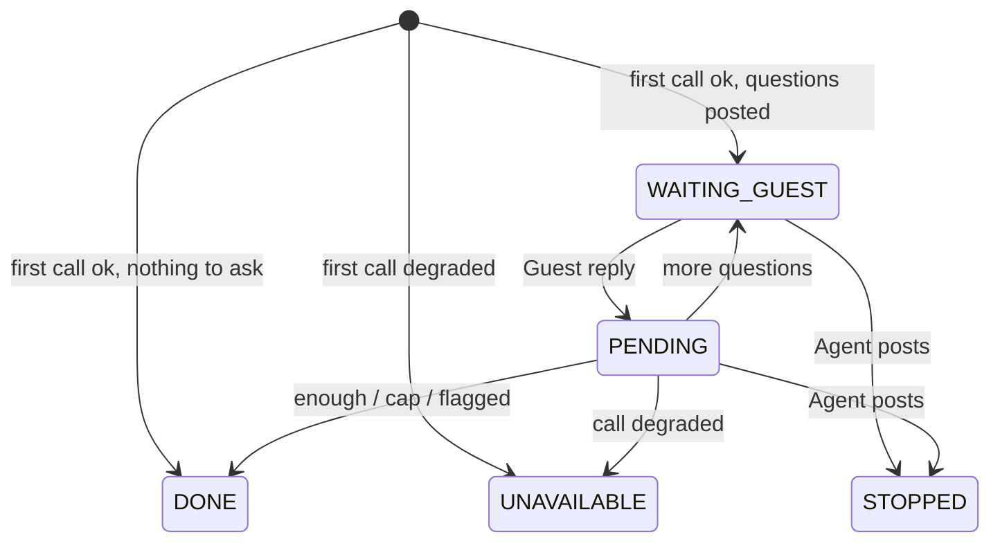

# Data Model

## Entities

### `ticket_assistants` (new; one row per ticket that the assistant touched)
| Entity | Attribute | Type | Null | Default | Range / rule |
|---|---|---|---|---|---|
| TicketAssistant | `ticket_id` | UUID | no | - | primary key; foreign key to `tickets(id)` |
| TicketAssistant | `state` | VARCHAR(16) | no | - | one of `PENDING`, `WAITING_GUEST`, `DONE`, `STOPPED`, `UNAVAILABLE` (CHECK) |
| TicketAssistant | `rounds` | SMALLINT | no | 0 | 0 to 5 (CHECK); the number of question messages posted |
| TicketAssistant | `flagged` | BOOLEAN | no | false | true once any call had `flagged = true` |
| TicketAssistant | `draft` | TEXT | yes | null | the rendered report, at most 4,000 characters (CHECK `char_length(draft) <= 4000`) |
| TicketAssistant | `draft_updated_at` | TIMESTAMPTZ | yes | null | set whenever `draft` is written |
| TicketAssistant | `last_message_id` | UUID | yes | null | the newest Guest message included in the last applied call; foreign key to `messages(id)` |
| TicketAssistant | `created_at` | TIMESTAMPTZ | no | - | row creation time |
| TicketAssistant | `updated_at` | TIMESTAMPTZ | no | - | last state or draft change |

### `messages` (existing; one constraint changes)
| Entity | Attribute | Type | Null | Default | Range / rule |
|---|---|---|---|---|---|
| Message | `author_role` | VARCHAR(10) | no | - | CHECK widens from `GUEST, HOST, AGENT` to `GUEST, HOST, AGENT, SYSTEM` (see Q1 in the index) |
| Message | `author_id` | UUID | no | - | for assistant messages: the SYSTEM user `a0000000-0000-0000-0000-0000000000ff` (V004) |

No other table changes. `tickets`, `audit_log` and `booking_messages` are unchanged; `audit_log.action_type` has no CHECK, so two new `AuditAction` constants need no migration.

## Keys and relationships
| From | To | Cardinality | On delete | Ownership / tenancy scope |
|---|---|---|---|---|
| `ticket_assistants.ticket_id` | `tickets.id` | 1 to 0..1 | no cascade (tickets are never deleted) | read only through Agent endpoints; a Guest or Host endpoint never returns it |
| `ticket_assistants.last_message_id` | `messages.id` | many to 0..1 | no cascade | internal |
| assistant `messages.author_id` | `users.id` (SYSTEM user) | many to 1 | no cascade | visible only in the ticket's GUEST thread to its Guest and to Agents |

## Lifecycle
| From state | To state | Triggered by (role) | Guard |
|---|---|---|---|
| (no row) | `WAITING_GUEST` | assistant job after `TicketOpenedEvent` (SYSTEM) | call ok, `enough` false, at least one screened question, `max-rounds >= 1`; row inserted with `rounds = 1` |
| (no row) | `DONE` | assistant job (SYSTEM) | call ok and (`enough` true, or no screened question remains, or `flagged`); `rounds = 0`, no message |
| (no row) | `UNAVAILABLE` | assistant job (SYSTEM) | call degraded with a code other than `DISABLED`, or the executor rejected the job |
| (no row) | (no row) | assistant job (SYSTEM) | the gateway code is `DISABLED` |
| `WAITING_GUEST` | `PENDING` | `MessagePostedEvent` for a Guest message in the GUEST thread (SYSTEM) | compare-and-set `UPDATE ... WHERE state = 'WAITING_GUEST'` changed one row; the ticket is `OPEN` or `IN_REVIEW` |
| `PENDING` | `WAITING_GUEST` | assistant job (SYSTEM) | call ok, not flagged, `enough` false, a screened question exists, `rounds < max-rounds`; `rounds` +1 |
| `PENDING` | `DONE` | assistant job (SYSTEM) | call ok and (`enough`, or no screened question, or `flagged`, or `rounds = max-rounds`); a closing message is posted if `rounds >= 1` |
| `PENDING` | `UNAVAILABLE` | assistant job (SYSTEM) | call degraded (any code, including `DISABLED` on a later turn) |
| `WAITING_GUEST`, `PENDING` | `STOPPED` | `MessagePostedEvent` for an Agent message in the GUEST thread (SYSTEM) | the row is in one of the two states |

`DONE`, `STOPPED` and `UNAVAILABLE` are terminal: no transition leaves them. A ticket resolved while the row is non-terminal is not changed by the assistant; its next trigger finds the ticket resolved and does nothing (the Guest cannot post to a resolved ticket either).

## Invariants
- At most one `ticket_assistants` row per ticket (primary key).
- `rounds` equals the number of messages by the SYSTEM user in the ticket's GUEST thread that contain questions (closing messages do not count).
- `rounds <= snoozeshare.assistant.max-rounds` at all times.
- `state = 'WAITING_GUEST'` implies the last message in the GUEST thread is an assistant question message.
- A row in a terminal state is never updated again, including `updated_at`.
- `agent_notes` is never written by an assistant code path.
- No `ticket_assistants` or assistant `messages` row exists for a ticket whose `raised_by_role` is `HOST`.
- `draft` is null until the first ok call is applied, and is replaced, never appended, by each later ok call; a degraded call leaves it unchanged.

## Migration and rollback
- Version: `V006__ticket_assistant.sql`. If another branch merges a `V006` first, this file is renumbered at merge, as W-DOMAIN did when W-AUTH had already taken V002.
- Existing rows: none are transformed. Existing tickets have no `ticket_assistants` row, which reads as "assistant did not run" (the detail response carries `assistant: null`). The `messages.author_role` CHECK is dropped by its Postgres-generated name `messages_author_role_check` and recreated with the four values; every existing row already satisfies it.
- Regenerate committed data: no. `desktop/db/*` is the desktop reference database and is unaffected; the backend has no committed seed for tickets.
- If it fails halfway: Flyway runs the migration in one transaction on PostgreSQL, so a failure leaves the schema at V005 and the application refuses to start (the existing behaviour for a failed migration). Rollback after a successful run is manual: drop `ticket_assistants`, delete messages whose `author_role` is `SYSTEM`, then restore the old CHECK; the application at the previous version ignores both.

## Architecture areas changed
- § 4.5 Repository & persistence - gains `ticket_assistants`, the `TicketAssistant` entity and `TicketAssistantRepository`, and the widened `messages.author_role` CHECK.
- § 4.6a Messaging (desktop area, still the messaging reference) and the web thread behaviour in § 4.14 and § 4.16 - a SYSTEM-authored message can appear in the GUEST thread.
- A new area, the ticket assistant (`com.snoozeshare.service.assistant`), described in `api.md`; § 4.11 is unchanged.
